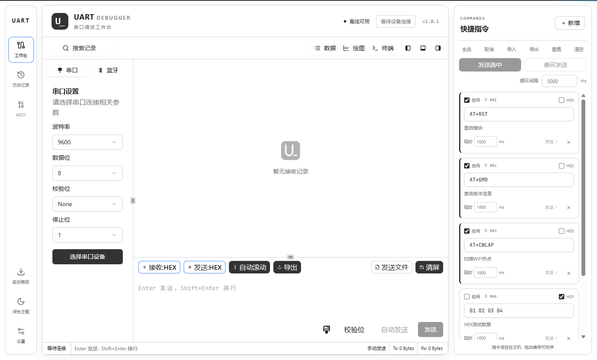
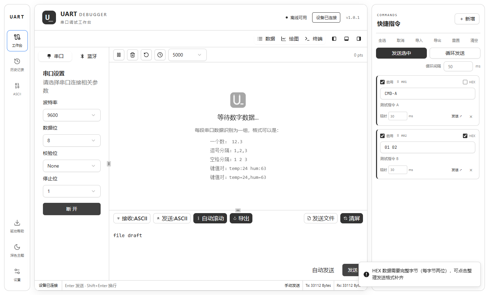

# UART Debugger

受波特律动串口助手启发，制作了一个面向 Windows 的串口调试工作台。串口与 BLE 设备收发、数据绘图、终端、快捷指令和本地记录集中在一个窗口内，全部离线运行，不需要账号，也不会上传任何数据。



## 功能

- **设备**：自动枚举串口与 BLE 设备，支持波特率、数据位、校验位、停止位设置
- **收发**：HEX / ASCII / 十进制显示，可选 UTF-8 或 GBK 编码、行尾符、定时与循环发送
- **视图**：数据、绘图、终端三种视图随时切换；绘图支持按行解析数值与键值对
- **快捷指令**：分组管理常用指令，支持延时、循环、导入导出
- **记录**：本地保存收发历史，可按关键字搜索，导出为 JSON
- **文件**：发送文件、保存接收数据
- **界面**：深色 / 浅色主题，等宽字体可替换为本地字体



## 运行

打包生成的便携版为单个 exe，双击即可运行，无需安装 Node.js 或浏览器（仅支持 Windows x64）。

也可以从源码启动：

```bash
npm install
npm run build     # 构建渲染进程
npm run desktop   # 打开 Electron 窗口
```

## 开发

```bash
npm install
npm run dev       # 浏览器调试（需 Chromium 内核，支持 Web Serial / Web Bluetooth）
npm run lint
```

## 打包

```bash
npm run build:win
```

产物输出到 `release/`，为单文件便携版 exe。打包前会自动收集依赖许可证到 `THIRD_PARTY_LICENSES.txt`。

## 目录

```text
electron/     Electron 主进程与预加载脚本
src/          Vue 3 渲染进程（组件、页面、组合式函数、工具）
public/       图标与内置字体
scripts/      图标生成与许可证收集脚本
```

## 许可证

本项目使用 MIT 许可证，详见 [LICENSE](LICENSE)。第三方依赖与内置字体的许可证见 `THIRD_PARTY_LICENSES.txt`（由 `npm run licenses` 生成）与 `public/fonts/`。
